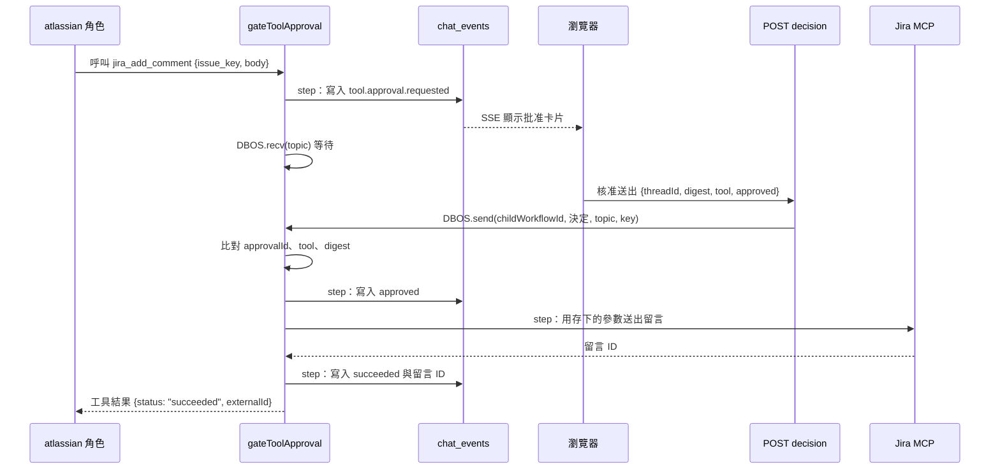

# 使用者批准的架構

這個 Target 讓 Agent 在 Jira 新增留言前先停下來，等使用者在畫面上按「核准送出」或「拒絕」。等待期間伺服器可以重啟，使用者回來後按下按鈕，Agent 從原本的位置接著做。

本章從 [Agent Routing Target](../subagents/architecture.md) 完成後的 Harness 開始。留言由 `atlassian` 角色提出，所以沿用 `delegate_task`、角色子 workflow、`testing_operations` 與 IO 預算。

## 為什麼不能只靠 prompt

在 prompt 寫「留言前先問使用者」，模型可能照做，也可能不照做。而且「問」只是一則文字回覆，使用者回答「好」以後，下一輪模型要重新產生留言內容，送出的文字未必是使用者看過的那段。

批准要由 host 執行：

- 模型呼叫 `jira_add_comment` 不會送出留言，只會建立一筆待批准的請求。
- 使用者看到的是 host 存下的確切文字。批准只是「是或否」，不能修改內容。
- 送出時，host 用存下的參數呼叫 Jira，不是用模型下一輪產生的參數。

## 等待要能撐過重啟

使用者可能幾分鐘後才回來按按鈕。用一個記憶體裡的 Promise 等待時，程序重啟後 Promise 就消失了，按鈕按下去沒有人接收。

DBOS 提供兩個 API 解決這件事：

- `DBOS.recv(topic, { deadlineEpochMS })`：workflow 在這裡暫停，等別人送訊息到這個 topic。等待狀態存在資料庫，程序重啟後 workflow 恢復，回到同一個 `recv` 繼續等。期限到了回傳 `null`。
- `DBOS.send(workflowId, message, topic, idempotencyKey)`：HTTP handler 把使用者的決定送給 workflow。訊息先存進資料庫，workflow 不在執行中也能送達。

相同的 `idempotencyKey` 只會送達一次。使用者連按兩次，或網路重送，workflow 只收到第一個決定。

## 檔案依責任拆分

依下列責任建立或修改模組。檔名是實作方向，不必逐字相同。

- `shared/tool-approval.ts`：留言參數、使用者決定、兩種事件的 zod schema，以及從事件算出卡片狀態的 `projectToolApprovals`。前後端共用。
- `server/harness/tool-approval.ts`：`gateToolApproval`。建立請求、`DBOS.recv` 等待、檢查決定、送出留言、記錄結果。
- `server/harness/tools/atlassian.ts`：`jiraCommentApproval` 與 `sendApprovedJiraComment`。用存下的參數呼叫 MCP 的 `jira_add_comment`，要求回傳留言 ID。
- `server/harness/tools/atlassian-policy.ts`：`jira_add_comment` 只能直接呼叫。MCP 服務改成可寫入、不自動重試。
- `server/harness/testing-child.ts`：`atlassian` 的模型迴圈加上 orchestration hook，攔下 `jira_add_comment`。
- `server/harness/testing-tools.ts`：把 `jira_add_comment` 的 description 改成「提出待批准的留言」，直接執行時丟出錯誤。
- `server/harness/run-store.ts`：讀回待批准的請求、算出留言結果給主 Agent、取消時喚醒等待中的 workflow。
- `server/chat.ts`：`POST /api/chat/approvals/:id/decision`，把決定 `DBOS.send` 給子 workflow。
- `server/harness/testing-run.ts`：`delegate_task` 的結果加上 `comment` 欄位。
- `src/components/tool-approvals.tsx`、`src/hooks/use-threads.ts`：批准卡片與送出決定。

## 一次批准的資料流

拒絕、過期或取消時，`gateToolApproval` 寫入對應狀態，回傳「不要再提出留言」的工具結果，不呼叫 Jira。

## Digest 把決定綁在一段文字上

請求的 `digest` 是下列內容的 SHA-256：角色與 workflow 的 ID、工具呼叫 ID、留言參數、目標 Jira 網站與期限。卡片送出決定時必須帶上同一個 digest，`gateToolApproval` 收到後再比對一次。

使用者看過的是 A 段文字，就不可能批准成 B 段文字。

## 只保證不會未經批准送出

留言送出是 DBOS step。Jira 已經收到留言，DBOS 卻還沒記下 step 的結果時，程序中斷，恢復後 DBOS 會重跑這個 step，Jira 會多一則留言。MCP 呼叫不帶 Jira 認得的去重鍵，所以這個空窗無法完全消除。

這和 README 第 2 節「Checkpoint 與副作用之間的空窗」講的是同一個問題。這個 Target 保證的是：

- 沒有批准就不送出。
- 送出的是使用者看過的文字。
- 拒絕、過期或取消後，同一個任務不能再提出留言。

它不保證留言只出現一次。測試也把這一點寫成預期行為。

接著依照[建立留言批准](implement-approval.md)完成整個流程。
