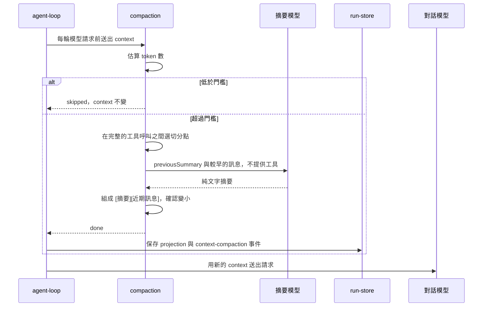

# Compact 的上下文架構

這個 Target 讓對話超過預算時，用摘要取代較早的訊息，同時保留完整原文給介面顯示。另外加入兩個入口：使用者輸入 `/compact` 手動壓縮，以及開一段不影響主對話的附屬對話（BTW），討論完再把摘要送回主對話。

本章從 [Code Mode Target](../code-mode/architecture.md) 完成後的 Harness 開始。沿用 `agent-loop.ts` 的模型與工具 steps、DBOS checkpoint、`chat_events` 事件紀錄，以及預留的附屬對話窗格。不需要先完成子 Agent 或批准流程。

## 介面顯示的歷史和模型收到的 context 分開保存

目前的 run 只有一份 `UIMessage[]`。介面顯示它，下一次模型請求也送出它。壓縮後兩者不再相同，所以把一份訊息拆成兩份：

```typescript
export type ConversationState = {
  display: UIMessage[];
  context: UIMessage[];
};
```

- `display` 只增加，不刪除。原始訊息全部保留，每次壓縮再加上一則摘要訊息，讓使用者看得到摘要內容。
- `context` 是下一次模型請求的訊息。壓縮後變成 `[摘要][保留的近期訊息]`。

`threads.messages` 保存 `display`。`chat_runs.projection` 改存 `{ version: 1, display, context, committedRevision }`。下一個 run 從 `committedRevision` 等於 thread 目前 revision 的那個 run 讀回 `context`。這個 run 稱為 context anchor。沒有 anchor 的舊 thread 直接用 `threads.messages` 當 context。但如果 `threads.messages` 裡已經有摘要，卻找不到 anchor，就拒絕請求。這時把含摘要的 display 當 context 送出，模型會同時收到摘要和被摘要的原文。

摘要訊息用 `metadata.fromSummary: true` 標記。介面用這個標記把它顯示成「壓縮摘要」。`advanceConversation` 也靠它判斷哪些訊息不從 context 複製到 display。

## 檔案依責任拆分

依下列責任建立或修改模組。檔名是實作方向，不必逐字相同。

- `server/harness/conversation.ts`：定義 `ConversationState` 和 `RunProjection`，用 `advanceConversation` 把模型和工具產生的新訊息同時加進 display 與 context。
- `server/harness/compaction.ts`：估算 token 數、選擇切分位置、送出摘要請求，再組成新的 context。
- `server/harness/model-turn.ts`：把供應商的 context 超限錯誤轉成 `ContextOverflowError`。
- `server/harness/agent-loop.ts`：在每次模型請求前檢查門檻。模型回報超限時，先壓縮再重試一次。
- `server/harness/run.ts`：把壓縮包成 DBOS steps，處理 `kind: "compact"` 的手動 run 和附屬對話的 run。
- `server/harness/run-store.ts`：保存 projection、寫入壓縮事件、讀回 context anchor，並管理附屬對話的資料列。
- `server/harness/prompts.ts`：放壓縮摘要和附屬對話摘要的 system prompt，以及摘要訊息的開頭說明。
- `shared/compaction-event.ts`：定義 `context-compaction` 自訂事件，前後端共用。
- `shared/side-chat.ts` 與 `server/side-chat.ts`：附屬對話的資料契約與 HTTP 路由。
- `src/composer-commands.ts`、`src/hooks/use-threads.ts`、`src/hooks/use-side-chats.ts`：解析 `/compact`、顯示壓縮狀態、管理附屬對話窗格。

`compaction.ts` 不直接寫資料庫。它回傳 `skipped`、`done` 或 `failed`，再由 `run.ts` 在 DBOS step 裡呼叫 `run-store.ts` 保存結果。

## 一次自動壓縮的資料流



模型回報超限時走另一條路：撤回這次請求已串流的內容，不檢查門檻直接壓縮，再重送一次。重送仍然超限，run 就失敗。

## DBOS 保存壓縮的結果

摘要請求是一次模型呼叫，結果不固定，所以壓縮要放進 DBOS step。準備摘要和保存結果分成兩個 steps：`compact:<turn>` 與 `publish-compact:<turn>`。程序在兩者之間中斷時，恢復後重用已完成的摘要，不會再呼叫一次摘要模型。

`operationId` 用 `<runId>/compact/<turn>` 組成。保存結果時，用 `compact:<operationId>` 當事件的 `event_key`。同一個 operation 已經保存過，就比對結果並直接返回，不重複寫入。

## 附屬對話是另一個 thread

附屬對話建立一個 `parent_thread_id` 指向主對話的 thread，起點是主對話當時的 display 與 context。附屬對話的 run 和主對話的 run 走同一套 `agent-loop`，所以也會自動壓縮。附屬對話的 run 不修改主對話。

使用者結束討論時，Harness 只摘要附屬對話裡新增的訊息，交給使用者編輯。確認後，摘要文字變成主對話的一則使用者訊息，並啟動一個主對話 run。附屬對話隨後刪除。

附屬對話不跨程序恢復。關閉窗格、重新整理頁面與伺服器重啟時，Harness 停下它的 run，再刪除它的資料。細節見[建立附屬對話](side-chat.md)。

接著依照[建立自動壓縮](implement-compaction.md)完成門檻、切分與超限重試。
